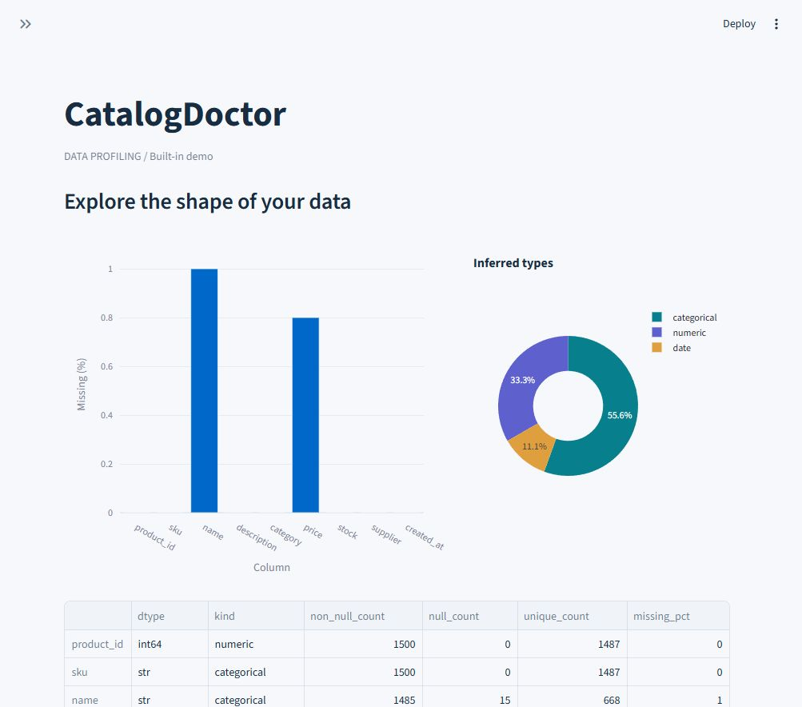
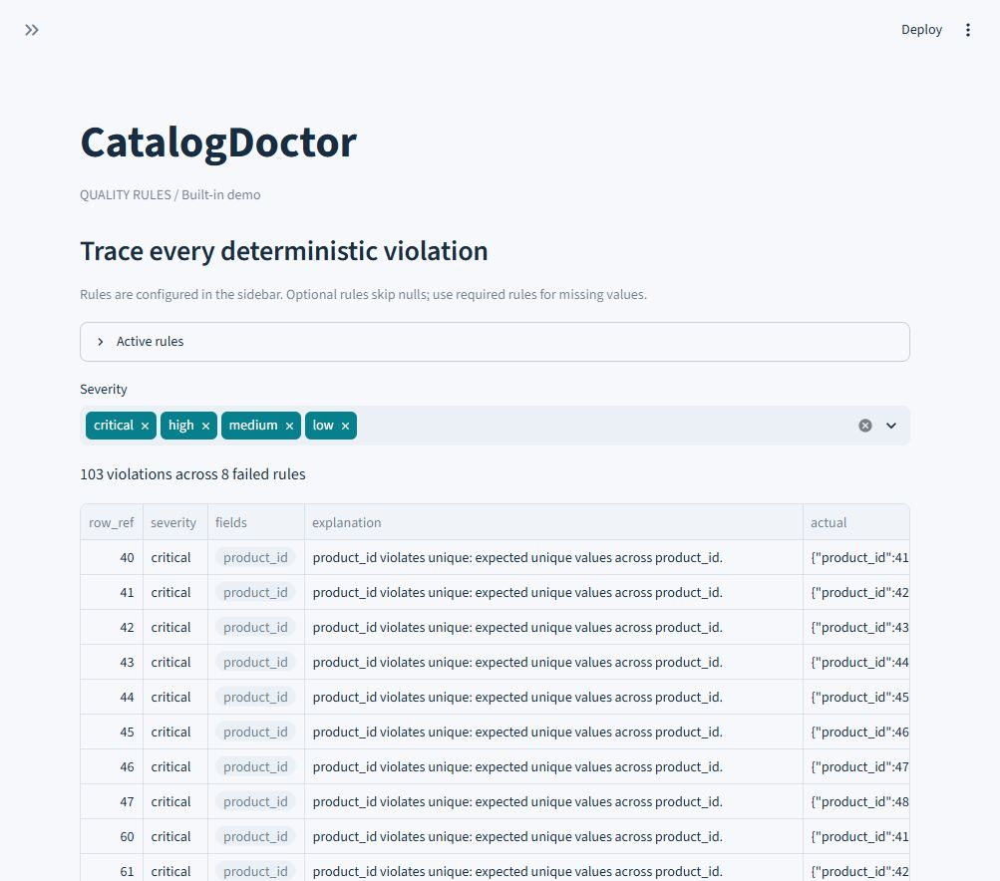
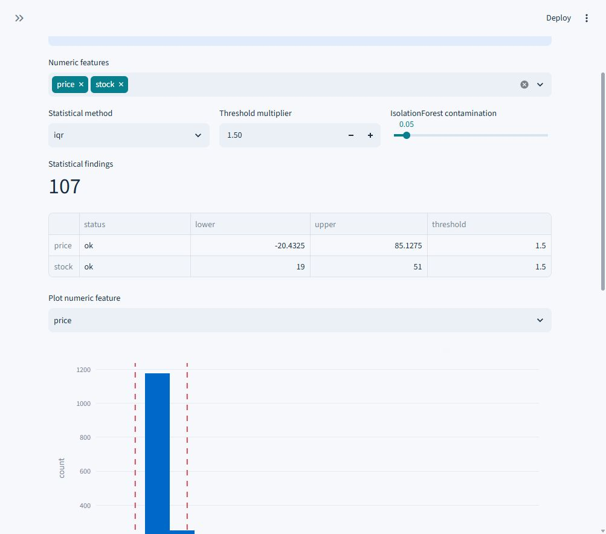
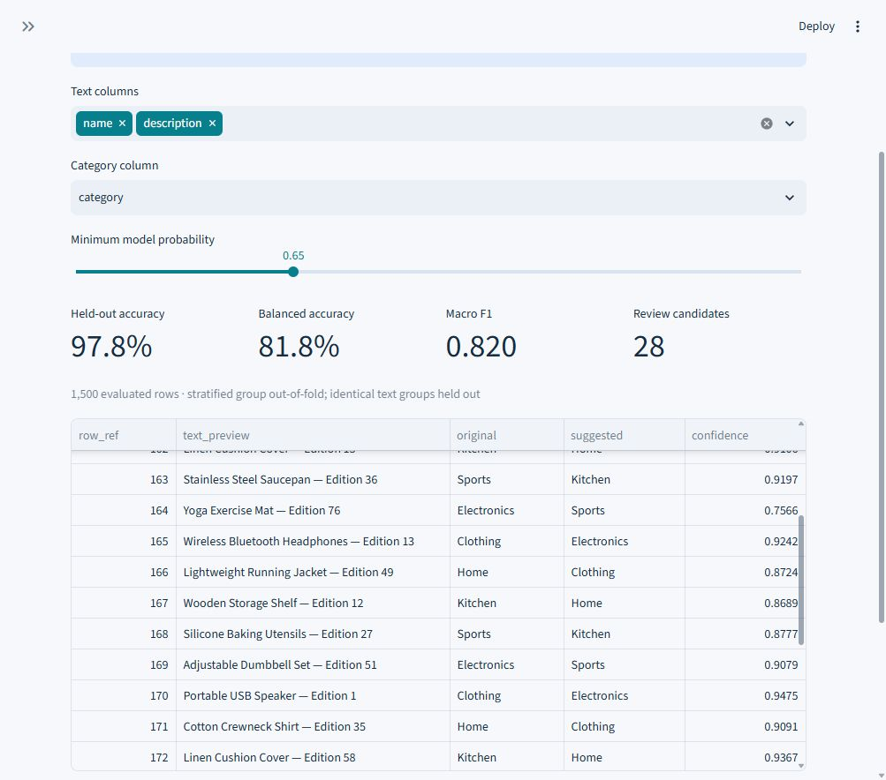
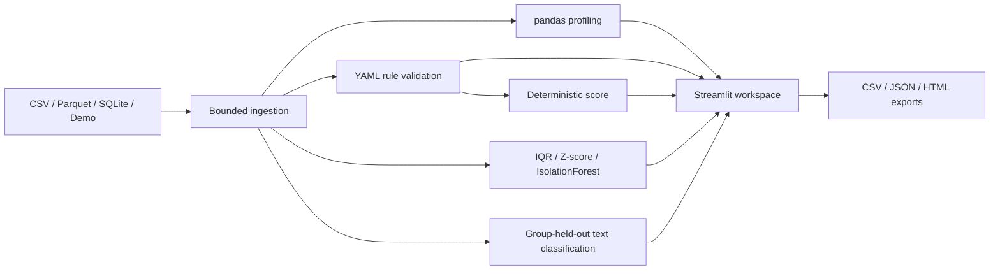

<div align="center">

# CatalogDoctor

**Explainable data-quality analysis for tabular datasets**

[](https://github.com/YoussefSelk/catalogdoctor/actions/workflows/ci.yml)
[](pyproject.toml)
[](LICENSE)

Python · pandas · SQLAlchemy · scikit-learn · Streamlit

</div>

CatalogDoctor profiles CSV, Parquet, and SQLite tables, validates configurable
quality rules, and identifies numerical outliers and suspicious category labels.
Every finding includes its original row reference, observed values, expected
condition, severity, and detection method. Results can be downloaded as CSV,
JSON, or a standalone HTML report.

## Why it exists

A catalog can look complete while containing repeated identifiers, invalid prices,
or plausible products assigned to the wrong category. CatalogDoctor makes these
problems inspectable: deterministic violations are kept separate from statistical
outliers and model suggestions. The tool helps an analyst decide what to review;
it never silently repairs the source data.

## Features

| Area | Implemented behavior |
| --- | --- |
| Ingestion | CSV encodings/separators, flat Parquet, read-only SQLite, built-in demo |
| Profiling | Missing cells, duplicate rows, cardinality, frequent/rare values, numeric and date summaries |
| Rules | Required, unique, numeric bounds, allowed values, regex, length, dates, cross-field comparisons, selected-field duplicates |
| Score | Completeness, uniqueness, validity, consistency; configurable weights and explicit denominators |
| Statistical review | Per-feature IQR/Z-score bounds and observed outliers |
| Numeric ML review | Seeded IsolationForest, median imputation, scores, descriptive feature comparisons |
| Classification | TF-IDF/logistic regression, group-held-out predictions, actual evaluation metrics |
| Exports | Formula-protected issue CSV, strict JSON, HTML with escaped dataset values |
| Engineering | Src package, CLI, pytest/Streamlit smoke tests, Ruff, mypy, Docker, GitHub Actions |

## Dashboard

These are screenshots of the actual running application using the synthetic demo.


<details><summary>Profiling, rule details, and model review</summary>






</details>

## Quick start

Python 3.11+ is required. No database server, cloud account, or API key is needed.

```bash
git clone https://github.com/YoussefSelk/catalogdoctor.git
cd catalogdoctor
python -m venv .venv
```

Activate the environment on Windows PowerShell:

```powershell
.venv\Scripts\Activate.ps1
```

Or on macOS/Linux:

```bash
source .venv/bin/activate
```

Then install and launch:

```bash
python -m pip install -r requirements.txt
python -m pip install --no-deps -e .
catalogdoctor dashboard
```

Open **http://localhost:8501**. The 1,500-row demo loads immediately.
The launcher uses the installed package, so it also works outside the checkout.

For development, [uv](https://docs.astral.sh/uv/) reproduces the complete locked environment:

```bash
uv sync --locked --extra dev
uv run --no-sync catalogdoctor dashboard
```

`uv.lock` records the runtime and development resolution. `requirements.txt` is a
runtime-only export with Python-version/platform markers, also used by Docker.
An ordinary `pip install -e '.[dev]'` works, but resolves dependency ranges anew.

## Data sources and row references

- **CSV:** upload UTF-8/UTF-8 BOM, CP1252, or Latin-1 with comma, semicolon, tab,
  or pipe separation. Only empty fields become null by default; literal `NA`,
  `null`, and padded identifiers remain evidence. Conservative numeric inference
  retains raw numeric lexemes in `DataFrame.attrs['raw_numeric']`; text-format
  rules and issue records use that evidence.
- **Parquet:** preserves native numeric/date types and stored indices. Nested
  arrays/objects are rejected with an instruction to flatten them.
- **SQLite:** choose an inspected table from a configured existing database.
  Connections use URI read-only mode; table names are reflected and quoted by
  SQLAlchemy. Arbitrary SQL is never accepted by the application.
- **Built-in demo:** generated in memory with seed 42, available in a clean wheel.

Defaults: **50 MiB file**, **100,000 rows**, **256 MiB decoded dataframe plus
retained CSV evidence**. Parquet and SQL reads are batched. Limits are enforced
without silent truncation; datasets above 50,000 rows show a warning. These are
application-level limits, not a hard operating-system memory sandbox.

`row_ref` is the zero-based position in the originally loaded dataset; it remains
unambiguous even with repeated source indices. `source_index` additionally retains
the original pandas/Parquet index. SQLite reads use primary-key order when available;
tables without a primary key do not have stable ordering across separate scans.

Configure SQLite on PowerShell:

```powershell
$env:CATALOGDOCTOR_SQLITE = 'examples/catalog.db'
catalogdoctor dashboard
```

Or on macOS/Linux:

```bash
CATALOGDOCTOR_SQLITE=examples/catalog.db catalogdoctor dashboard
```

Uploaded and SQLite datasets start with no domain-specific rules. Paste your own
YAML into the sidebar; the built-in demo starts with the supplied catalog rules.

## Reproducible examples

```bash
python examples/generate_data.py
catalogdoctor scan --output demo-analysis.json
catalogdoctor scan examples/catalog.csv --rules examples/rules.yml --output csv-analysis.json
catalogdoctor scan examples/catalog.parquet --rules examples/rules.yml --output parquet-analysis.json
catalogdoctor scan examples/catalog.db --table products --rules examples/rules.yml --output sql-analysis.json
```

The generator writes CSV, Parquet, SQLite, rules, and `ground_truth.json`.
The manifest records 135 deliberately changed cells with their original and injected
values. Injections include 15 missing names, 12 missing prices, eight duplicated IDs
and SKUs, eight negative prices, eight negative stocks, five unknown categories,
eight unusually high prices, 15 changed category labels, three invalid dates,
and five fully duplicated rows. Overlapping violations and additional naturally
occurring outliers mean detected issue counts need not equal injection counts.

For example, these are the SQL aggregates used by the ingestion layer:

```sql
SELECT COUNT(*) AS rows,
       COUNT(*) - COUNT(name) AS missing_names,
       COUNT(*) - COUNT(price) AS missing_prices
FROM products;
```

SQL aggregates and loaded rows share an explicit SQLite read transaction. The test
suite includes a WAL database that changes during the scan to verify consistency.

## Quality rules

```yaml
rules:
  - {id: id-required, column: product_id, type: required, severity: critical}
  - {id: id-unique, column: product_id, type: unique, severity: critical}
  - {column: price, type: min_value, value: 0, severity: high}
  - {column: category, type: allowed_values, values: [Electronics, Clothing, Home, Kitchen, Sports]}
  - {column: sku, type: regex, pattern: '^[A-Z]{3}-[0-9]{4}$', severity: high}
  - {column: name, type: string_length, min_length: 3, max_length: 120}
  - {column: created_at, type: date_validity, format: '%Y-%m-%d'}
```

Also supported: `max_value`, `cross_field` with `other_column` and a numeric
`operator` (`lt`, `le`, `eq`, `ne`, `ge`, `gt`), and `duplicates` with `columns`.
`cross_field` compares finite numeric values. Date rules require exact round trips
through the configured format. Regex uses full-string matching. Only trusted YAML
should be used; complex regular expressions can be expensive.

Optional rules skip nulls; add `required` to validate missing values. Required
also rejects blank/whitespace strings. Unique/subset-duplicate rules flag every
non-null member of a duplicated group. Missing rule columns, invalid parameters,
unknown fields, and duplicate rule IDs produce explicit configuration errors.
YAML parsing uses `safe_load`, with Pydantic schema validation.

## Profiling

Dataset summaries include shape, missing cells, redundant exact duplicate rows
(`keep='first'`), and inferred type distribution. Column summaries include null/non-null
counts, distinct values, uniqueness among non-null values, and ten frequent values.
Categorical columns include rare values below 1% of non-null observations.

Numeric summaries use finite values and report mean, median, population standard
deviation, extrema, quartiles, and IQR. Nonfinite counts remain explicit. Native
datetime columns and columns with configured date formats report valid date bounds,
missing counts, and invalid date counts. Mixed numeric/text columns are retained
as categorical evidence rather than being silently converted into missing data.

## Statistical and ML review

**IQR:** flags values outside `[Q1 − k·IQR, Q3 + k·IQR]`, default `k=1.5`.
**Z-score:** flags values outside `mean ± k·population_std`, default `k=3`.
Both expose exact bounds, ignore missing/nonfinite values, skip fewer than four
finite observations, and handle constants without division by zero. A nonconstant
column with zero IQR still uses the stated bounds and can flag nonmedian values.

**IsolationForest:** uses 150 trees, seed 42, selected numeric features and median
imputation. Default feature selection excludes `id`, `sku`, `*_id`, and `*_key`;
other business identifiers should be deselected manually. All-null and constant
features are excluded. At least 20 rows with numeric evidence are required; rows
with every selected value missing are omitted rather than manufactured from medians.
Contamination is configurable in `(0, 0.5]`, default 0.05.

Scores are `−decision_function`: positive scores are flagged, larger is more unusual.
Comparisons to feature medians/IQRs provide descriptive context. They do **not**
identify causal reasons for IsolationForest predictions. Review flags are separate
from deterministic rule violations and never enter the quality score.

## Suspicious classifications

TF-IDF unigrams/bigrams feed balanced logistic regression. Three stratified group
folds produce out-of-fold predictions: each reviewed row is predicted by a model
that did not train on its text group. Normalized identical texts stay together, and
TF-IDF is fitted within each training fold. There is no training-set accuracy presented
as evaluation performance.

Requires 40 labeled nonblank rows, two classes, five records per class, and three
distinct text groups per class. Infeasible folds and empty vocabularies yield helpful
unavailable states. Accuracy, balanced accuracy, and macro F1 measure agreement with
existing labels. Disagreements are shown only above a configurable probability
threshold (default 0.65). Probabilities are **uncalibrated**; suggestions are not
ground truth. Noisy labels can teach the model existing errors, and unknown classes
cannot be discovered.

## Quality score

Each measured component is `100 × (1 − failed_units / eligible_units)`:

| Dimension | Failed units | Denominator |
| --- | --- | --- |
| Completeness | Distinct null cells, plus blank cells rejected by required rules | All dataset cells |
| Uniqueness | Union of redundant exact rows and rows violating configured unique/duplicate rules | All rows |
| Validity | Distinct `(row_ref, affected-field tuple)` failing nonstructural rules | Distinct eligible non-null row/field tuples covered by those rules |
| Consistency | Distinct failed cross-field row/field tuples | Distinct eligible non-null cross-field tuples |

Multiple checks of the same row/fields do not multiply the penalty in a component.
Different dimensions are intentionally distinct measurements. Configured uniqueness
rules flag all members of a duplicate group; the baseline exact-duplicate count only
counts redundant copies. The UI labels these two counts separately.

Default weights are completeness 0.35, uniqueness 0.25, validity 0.25, consistency 0.15.

```text
global = Σ(weight[d] × component[d]) / Σ(weight[d])
         over dimensions with a nonzero denominator and positive weight
```

Unmeasured dimensions are unavailable and their weights are renormalized. An empty
dataset, or no positively weighted measured dimension, has an unavailable score.
Severity is reported separately and does not secretly alter the formula. Statistical,
IsolationForest and classification flags are excluded. A high score can coexist with
important isolated violations: inspect critical findings rather than relying on the
aggregate alone. There is no persisted scan history or invented historical comparison.

## Architecture



Domain logic has no Streamlit dependency. `reporting.analyze` is the reusable pipeline;
the CLI and dashboard consume it. Streamlit caches serializable analyses with bounded
`cache_data` entries keyed by values, schema and original CSV evidence. `cache_resource`
reuses the read-only SQLite connection pool, while database reads remain fresh.
Changing a severity filter or navigation does not refit models. Exported reports include
the most recently chosen review settings for the current dataset.

See [the design and execution record](docs/architecture.md).

## Docker

```bash
docker build -t catalogdoctor .
docker run --rm -p 127.0.0.1:8501:8501 catalogdoctor
```

The Python slim image uses locked runtime dependencies, runs as UID 10001, exposes
8501, disables usage telemetry, and includes an HTTP health check. To analyze external
SQLite data, mount the dataset directory read-only:

```bash
docker run --rm -p 127.0.0.1:8501:8501 \
  -v /absolute/dataset-directory:/data:ro \
  -e CATALOGDOCTOR_SQLITE=/data/catalog.db catalogdoctor
```

Select **SQLite table** in the sidebar. The container user needs read permissions.
CSV/Parquet files can be uploaded through the browser. The application is intended
for local use; authentication and multi-user isolation are not implemented.

## Tests and checks

```bash
uv sync --locked --extra dev
uv run --no-sync ruff check .
uv run --no-sync ruff format --check .
uv run --no-sync mypy
uv run --no-sync pytest -W error
uv run --no-sync python examples/generate_data.py
uv run --no-sync python -m build
```

Tests exercise real CSV, Parquet and SQLite files; nullable/mixed/empty data; every
rule family; weight/denominator correctness; outlier boundaries; seeded IsolationForest;
classification disagreements and leakage safeguards; export escaping; and all six
Streamlit views. CI runs Python 3.11/3.13, deterministic example checks, an independent
wheel install, and Docker startup. The CI badge links to actual workflow runs; no
coverage percentage is claimed.

## Limitations and roadmap

- In-memory analysis is bounded for local datasets, not a distributed warehouse.
- Flat scalar columns only; no automatic nested-schema flattening.
- CSV empty fields are null; configurable domain-specific null tokens are a future feature.
- Regex configuration is trusted input; no regex execution timeout.
- Model flags depend on thresholds, distributions, and existing label quality.
- No automatic repairs, persisted history, scheduled monitoring, or multi-user authentication.
- HTML export is an escaped, self-contained evidence report; dashboard charts are not embedded.

Potential follow-ups: persisted scan comparisons, calibrated category probabilities,
explicit schema/null-token configuration, and opt-in remediation with audit trails.
These are roadmap items, not current capabilities.

## License

[MIT](LICENSE). Demo data is synthetic and contains no personal information.
